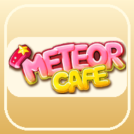

<div align="center">
  
  <h1>METEOR CAFE</h1>
  <p><strong>Preservação digital · Java ME · Android</strong></p>
  <p>Um projeto independente para preservar e executar Meteor Cafe em dispositivos Android modernos.</p>
  <p>
    <a href="https://github.com/ChatSamuel/meteor-cafe-apk/actions/workflows/build-meteor.yml">
      
    </a>
    <a href="https://github.com/ChatSamuel/meteor-cafe-apk/actions/workflows/build-meteor.yml">
      
    </a>
    
  </p>
</div>

---

## Sobre o projeto

Este repositório documenta um trabalho independente de preservação e compatibilidade de **Meteor Cafe**, jogo originalmente distribuído para celulares Java ME. O objetivo é executá-lo em um aplicativo Android dedicado, usando o runtime do [J2ME-Loader](https://github.com/nikita36078/J2ME-Loader) e preservando o máximo possível da experiência original.

A base de referência é a **segunda versão dedicada aprovada: 1.1.0 (`versionCode 2`)**. Ela foi instalada e testada pelo responsável pelo projeto em um Samsung Galaxy A05.

> **Versão preservada:** o aplicativo continua exibindo o nome **Meteor Cafe** e utiliza o logotipo original fornecido com o jogo. Não usamos “Debug” ou “Teste” como nome de aplicativo.

## Baixar e instalar

<div align="center">
  <a href="https://github.com/ChatSamuel/meteor-cafe-apk/actions/workflows/build-meteor.yml">
    
  </a>
</div>

1. Abra o workflow **Compilar METEOR CAFE 1.1.0** no GitHub Actions.
2. Entre na execução mais recente com status verde (**Success**).
3. Na seção **Artifacts**, baixe `METEOR-CAFE-1.1.0-ANDROID`.
4. Extraia o ZIP baixado e abra `METEOR_CAFE_1.1.0.apk` no Android.
5. Se o Android solicitar, autorize temporariamente a instalação de aplicativos pelo navegador/gerenciador de arquivos usado para abrir o APK.

Consulte [`docs/INSTALLATION.md`](docs/INSTALLATION.md) para instruções e solução de problemas.

**Sobre o download:** o botão leva às compilações do GitHub Actions. O APK fica disponível como artefato temporário da execução; ainda não há Release pública permanente. A publicação de uma Release deve aguardar a verificação dos direitos e o contato com os titulares do jogo.

## Capturas do Galaxy A05

<div align="center">
  
  
</div>

As imagens são capturas reais fornecidas durante os testes do aplicativo no Galaxy A05.

## O que inclui a base 1.1.0

- Aplicativo Android dedicado que inicia diretamente Meteor Cafe.
- Nome exibido no launcher: **Meteor Cafe**.
- Logotipo original mantido no ícone do aplicativo.
- Canvas original de 240 × 320, com preservação de proporção.
- Extensão de fundo suavizada para aproveitar melhor a tela alta do Galaxy A05, sem esticar os sprites.
- Ajuste vertical de **+8 pixels lógicos** nos quatro botões coloridos e nos respectivos alvos de toque.
- JAR original preservado separadamente e hashes SHA-256 conferidos.

## Compatibilidade e limitações conhecidas

| Item | Situação |
|---|---|
| Samsung Galaxy A05, orientação retrato | Testado pelo responsável pelo projeto |
| Canvas e proporção original | Preservados |
| Fundo preto excedente | Substituído por extensão visual suavizada |
| Ícone original e nome Meteor Cafe | Mantidos |
| Espaçamento dos botões coloridos | Ajuste inicial aplicado; refinamento ainda desejado |
| Orientação paisagem | Não faz parte da base estável 1.1.0 |
| Outros aparelhos Android | Ainda não verificados de forma abrangente |

A área lógica original do jogo é menor que a tela física moderna. A extensão do fundo preenche o espaço externo; ela não amplia automaticamente a área de gameplay nem estica personagens, mesas ou controles.

## Estrutura do repositório

```text
.
├── README.md
├── NOTICE.md
├── CHANGELOG.md
├── CONTRIBUTING.md
├── SECURITY.md
├── android/
│   └── METEOR_CAFE_APK_DEDICADO/
│       ├── original/                 # JAR original preservado
│       └── vendor/J2ME-Loader/       # projeto Android e runtime
├── assets/brand/                     # ícones e identidade original
├── screenshots/                      # capturas do Galaxy A05
├── docs/                             # instalação, build, técnica e créditos
└── .github/workflows/
    └── build-meteor.yml
```

O código do projeto Android fica navegável diretamente na pasta `android/`; não é necessário abrir um ZIP aninhado para consultar os arquivos-fonte.

## Compilação

O workflow prepara Java 21, Android SDK, Build Tools e NDK requeridos pelo projeto, restaura a dependência TinySoundFont e executa a variante Android `meteorDebug`. O tipo `debug` é uma configuração interna de assinatura de desenvolvimento; **o nome exibido do aplicativo permanece Meteor Cafe** e o artefato é renomeado para `METEOR_CAFE_1.1.0.apk`.

Veja [`docs/BUILD.md`](docs/BUILD.md) e [`docs/TECHNICAL.md`](docs/TECHNICAL.md).

## Créditos e direitos

Os créditos encontrados no JAR analisado identificam **3 Dynamics (Asia) Limited** como desenvolvedora/produtora e **THQ** como distribuidora. O manifesto registra `MIDlet-Vendor: THQ` e `Created-By: Metaflow`. Esse último campo não comprova que Metaflow seja o titular ou desenvolvedor legal do jogo. O titular atual dos direitos ainda não foi verificado.

Meteor Cafe, seu logotipo, personagens, músicas, gráficos e JAR original são conteúdo de terceiros. Este repositório não reivindica propriedade sobre esses elementos nem afirma possuir autorização de redistribuição. Leia [`NOTICE.md`](NOTICE.md) e [`docs/CREDITS_AND_RIGHTS.md`](docs/CREDITS_AND_RIGHTS.md).

## Contribuições

Relatos de compatibilidade, documentação e melhorias técnicas são bem-vindos. Consulte [`CONTRIBUTING.md`](CONTRIBUTING.md) antes de abrir uma contribuição. Não envie tokens, senhas, chaves de assinatura ou outros dados sensíveis.

---

<div align="center">
  <strong>Preservar. Compatibilizar. Documentar.</strong><br />
  <sub>Projeto independente de preservação; sem afiliação ou endosso declarado pelos titulares do jogo.</sub>
</div>
