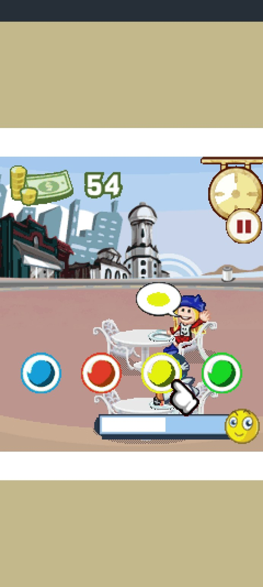

<div align="center">
  
  <h1>METEOR CAFE</h1>
  <p><strong>Digital preservation · Java ME · Android</strong></p>
  <p>A Java ME classic, preserved for modern Android devices.</p>
  <p>
    <a href="https://github.com/ChatSamuel/meteor-cafe-apk/actions/workflows/build-meteor.yml">
      
    </a>
    <a href="https://github.com/ChatSamuel/meteor-cafe-apk/actions/workflows/build-meteor.yml">
      
    </a>
    
  </p>
</div>

---

## About

**Meteor Cafe** is a café-management game originally released for Java ME mobile phones. This project preserves the original game experience in a dedicated Android application, using the J2ME-Loader runtime as its compatibility layer.

The work focuses on keeping the original game intact: its gameplay, visual assets, music, sound effects, logo and overall presentation remain the reference for the Android version.

## Download

<div align="center">
  <a href="https://github.com/ChatSamuel/meteor-cafe-apk/actions/workflows/build-meteor.yml">
    
  </a>
</div>

1. Open the [Meteor Cafe Android build workflow](https://github.com/ChatSamuel/meteor-cafe-apk/actions/workflows/build-meteor.yml).
2. Select the latest successful run.
3. Find the **Artifacts** section and download `METEOR-CAFE-1.1.0-ANDROID`.
4. Extract the downloaded archive and open `METEOR_CAFE_1.1.0.apk` on your Android device.
5. Approve installation from the file manager or browser when Android requests permission.

The workflow page contains the available build artifacts. See [Installation](docs/INSTALLATION.md) for the full instructions.

## Screenshots

<div align="center">
  
  
</div>

These screenshots were captured during testing on a Samsung Galaxy A05.

## Android version 1.1.0

- Dedicated Android application that opens Meteor Cafe directly.
- Original application name and game logo retained.
- Original Java ME canvas dimensions and aspect ratio preserved.
- Portrait layout centered on the Samsung Galaxy A05 display.
- Soft background extension fills unused screen space without stretching the playable area.
- A small vertical adjustment was applied to the four coloured order buttons and their touch targets.
- The untouched original JAR is retained separately for reference and integrity checks.

## Compatibility

| Device or feature | Status |
|---|---|
| Samsung Galaxy A05 · portrait | Tested |
| Original 240 × 320 canvas proportions | Preserved |
| Game sprites and logical play area | Not stretched |
| Original app logo and title | Retained |
| Four coloured order buttons | Initial spacing adjustment applied |
| Landscape orientation | Not included in version 1.1.0 |
| Other Android devices | Not yet broadly verified |

The original game uses a 240 × 320 canvas, with a 240 × 268 logical play area centered inside it. The Android display is larger, so the unused outer space is filled visually. The game itself is not expanded or distorted to match the phone's full height.

## Repository layout

```text
.
├── README.md
├── NOTICE.md
├── CHANGELOG.md
├── CONTRIBUTING.md
├── SECURITY.md
├── android/
│   └── METEOR_CAFE_APK_DEDICADO/
│       ├── original/             # Untouched original game JAR
│       └── vendor/J2ME-Loader/   # Android runtime and dedicated launcher
├── assets/brand/                 # Original app identity assets
├── screenshots/                  # Device screenshots
├── docs/                         # Installation, build, technical notes and credits
└── .github/workflows/
    └── build-meteor.yml
```

The Android source is available directly under `android/`; there is no need to unpack a nested source archive to browse it.

## Build

The repository workflow prepares the required Java, Android SDK, Build Tools and NDK components, restores the TinySoundFont dependency, checks the game JAR hashes and builds the dedicated Android variant.

Build instructions and environment details are documented in [Build](docs/BUILD.md). Architecture and game compatibility notes are available in [Technical notes](docs/TECHNICAL.md). The release signing and Android security process is documented in [Android Security and Distribution](docs/ANDROID_SECURITY_AND_TRUST.md).

## Original credits

The in-game credits identify **3 Dynamics (Asia) Limited** as the developer and producer, and **THQ** as the distributor. Corporate records document the later acquisition of 3 Dynamics by the group now known as **Century Energy International Holdings Limited**. The available records establish the company acquisition history; they do not, by themselves, establish the present ownership of the copyright in Meteor Cafe.

See [Credits and rights](docs/CREDITS_AND_RIGHTS.md) for the source records and full attribution.

---

<div align="center">
  <strong>Preserving the game. Keeping its history visible.</strong>
</div>
