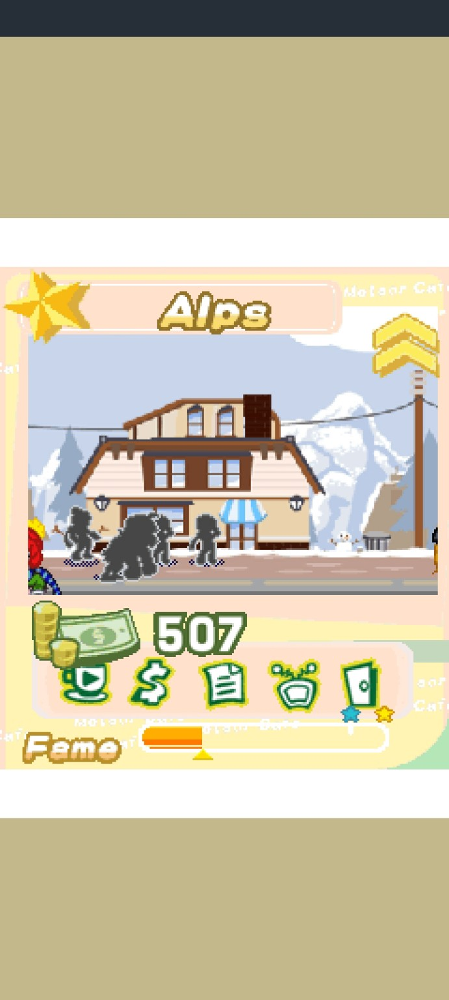

<div align="center">
  
  <h1>METEOR CAFE</h1>
  <p><strong>A Java ME classic, preserved for modern Android devices.</strong></p>
  <p>An independent digital-preservation and compatibility project.</p>
  <p>
    <a href="https://github.com/ChatSamuel/meteor-cafe-apk/actions">
      
    </a>
    <a href="https://github.com/ChatSamuel/meteor-cafe-apk/actions">
      
    </a>
    
  </p>
</div>

---

## About Meteor Cafe

**Meteor Cafe** is a café-management game originally created for Java ME mobile phones. This repository preserves the original game within a dedicated Android application, allowing the classic Java ME experience to run on a modern device through the [J2ME-Loader](https://github.com/nikita36078/J2ME-Loader) compatibility runtime.

The purpose of this project is simple: keep the game accessible, document how it works, and preserve the details that make the original experience recognizable. The original game remains the centre of the project. Its name, logo, visual identity, gameplay, music and sound effects are treated as part of the work being preserved—not as material to be casually replaced or redesigned.

This is an independent effort, maintained with respect for the people and companies whose work made Meteor Cafe possible.

## Download the Android application

<div align="center">
  <a href="https://github.com/ChatSamuel/meteor-cafe-apk/actions">
    
  </a>
  <p><sub>Android application · Version 1.1.0</sub></p>
</div>

The APK is published as a GitHub Actions build artifact. To download it:

1. Open the repository's [Actions page](https://github.com/ChatSamuel/meteor-cafe-apk/actions).
2. Select **Compilar METEOR CAFE 1.1.0** from the workflow list.
3. Open the most recent run marked **Success**.
4. Scroll to **Artifacts** and download **METEOR-CAFE-1.1.0-ANDROID**.
5. Extract the downloaded ZIP file. The installer is named `METEOR_CAFE_1.1.0.apk`.

GitHub Actions artifacts are temporary and follow the retention period configured in the build workflow. If the latest artifact has expired or no successful build is listed, start the workflow again with **Run workflow** and use the artifact from the new successful run.

For installation details, see [Installation guide](docs/INSTALLATION.md).

## Screenshots

<div align="center">
  
  
</div>

The screenshots show the dedicated Android application running on a Samsung Galaxy A05 in portrait orientation.

## The Android edition

The Android edition is designed to launch Meteor Cafe directly, without requiring the user to configure a general-purpose Java ME emulator. The compatibility runtime is included in the application, while the original game JAR remains available in the repository for technical reference and integrity checks.

The current reference build is **Android version 1.1.0 (`versionCode 2`)**. It retains the original application title and logo and keeps the original game canvas proportions.

### What has been preserved

- The original game JAR is integrated into the dedicated Android application.
- The original 240 × 320 Java ME canvas proportions are retained.
- The game's logical play area and artwork are not stretched to fill a modern phone display.
- The original Meteor Cafe name and application icon are retained.
- The original music and sound resources remain part of the game experience.
- An untouched copy of the original JAR is kept separately, with its SHA-256 hash recorded.

### Android adaptation

Modern phone displays are taller and have different proportions from the screens for which Java ME games were designed. On the Samsung Galaxy A05 reference device, the game is centred in portrait orientation. A softened visual background fills the unused outer area, while the original play area keeps its proportions.

The four coloured order buttons and their corresponding touch targets received an initial vertical adjustment of **8 logical pixels**. This keeps the visible controls and their touch areas aligned while preserving the underlying game layout.

## Compatibility

| Device or feature | Current status |
|---|---|
| Samsung Galaxy A05 · portrait | Tested on the reference device |
| Original 240 × 320 canvas proportions | Preserved |
| Original game artwork and logical play area | Not stretched |
| Original application name and icon | Retained |
| Coloured order-button spacing | Initial adjustment applied; further refinement may be useful |
| Landscape orientation | Not included in version 1.1.0 |
| Other Android devices | Not yet broadly verified |
| Full gameplay, audio and save-data coverage | Further testing is still useful |

The original game uses a 240 × 320 canvas, with a 240 × 268 logical game area centred inside it. The Android reference device has a 720 × 1600 display. The additional screen space is handled outside the original play area; it does not enlarge the game's logical field or stretch its characters, tables or controls.

See [Project status](docs/STATUS.md) and [Technical overview](docs/TECHNICAL.md) for further details.

## Project structure

```text
.
├── README.md
├── NOTICE.md
├── CHANGELOG.md
├── CONTRIBUTING.md
├── SECURITY.md
├── android/
│   └── METEOR_CAFE_APK_DEDICADO/
│       ├── original/                 # Preserved original game JAR
│       └── vendor/J2ME-Loader/       # Android project and compatibility runtime
├── assets/brand/                     # Original app identity assets
├── screenshots/                      # Reference-device screenshots
├── docs/                             # Installation, build, technical and rights notes
└── .github/workflows/
    └── build-meteor.yml              # Android build workflow
```

The Android project can be browsed directly under `android/`. The source is not hidden inside an additional archive.

## Building from source

The Android project is located at:

`android/METEOR_CAFE_APK_DEDICADO/vendor/J2ME-Loader`

The GitHub Actions workflow prepares the Java and Android build environment, restores the TinySoundFont dependency used for MIDI playback, verifies the original and integrated game JAR files, and runs the dedicated Meteor build task.

For local builds and environment requirements, see [Build instructions](docs/BUILD.md). The workflow publishes the resulting APK as the `METEOR-CAFE-1.1.0-ANDROID` artifact.

## Original credits and project acknowledgements

The credits found inside the examined original game identify the following companies:

| Contribution | Original credit |
|---|---|
| Developer and producer | **3 Dynamics (Asia) Limited** |
| Distributor | **THQ** |
| Copyright notice in the game | **© 2010** |

Public corporate records document the later acquisition of 3 Dynamics (Asia) Limited by the corporate group that subsequently became **Century Energy International Holdings Limited**. This is included as part of the company's history; the acquisition record alone does not establish who currently owns the copyright in Meteor Cafe.

The examined game files do not provide a verifiable list of individual developers. The `Created-By: Metaflow` manifest field is not treated as an individual authorship credit.

The Android compatibility layer incorporates **J2ME-Loader**, and the build restores **TinySoundFont**. Their licences and notices are documented in [NOTICE.md](NOTICE.md) and the retained third-party notices in the Android source tree.

For the supporting records and fuller attribution, see [Credits and rights history](docs/CREDITS_AND_RIGHTS.md).

## Rights and scope

Meteor Cafe and its original game materials—including the JAR, logo, characters, graphics, music and sound effects—are credited to their original creators and rights holders. This repository is an independent preservation and Android-compatibility project. It does not claim ownership of the original game, and it is not an official project of or endorsed by 3 Dynamics (Asia) Limited, THQ or Century Energy International Holdings Limited.

The open-source licences applying to J2ME-Loader and TinySoundFont do not grant rights to the original Meteor Cafe materials. The repository's notices describe the separate origins of these components. See [NOTICE.md](NOTICE.md) for details.

## Contributions and feedback

Helpful reports about device compatibility, installation, touch controls, audio, saved progress or technical documentation are welcome. Please include the Android device model, Android version and the steps needed to reproduce an issue.

Before contributing, please read [CONTRIBUTING.md](CONTRIBUTING.md). For security-related reports, use the guidance in [SECURITY.md](SECURITY.md). Please do not post passwords, signing keys, access tokens or other private information in public issues.

## Further documentation

- [Installation guide](docs/INSTALLATION.md)
- [Build instructions](docs/BUILD.md)
- [Technical overview](docs/TECHNICAL.md)
- [Project status](docs/STATUS.md)
- [Credits and rights history](docs/CREDITS_AND_RIGHTS.md)
- [Android security and distribution](docs/ANDROID_SECURITY_AND_TRUST.md)
- [Third-party notices](NOTICE.md)
- [Changelog](CHANGELOG.md)

---

<div align="center">
  <strong>Preserving a piece of mobile gaming history—one detail at a time.</strong>
  <p><sub>Thank you for taking an interest in Meteor Cafe and in the work of preserving it.</sub></p>
</div>
